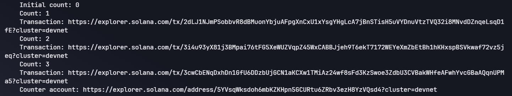
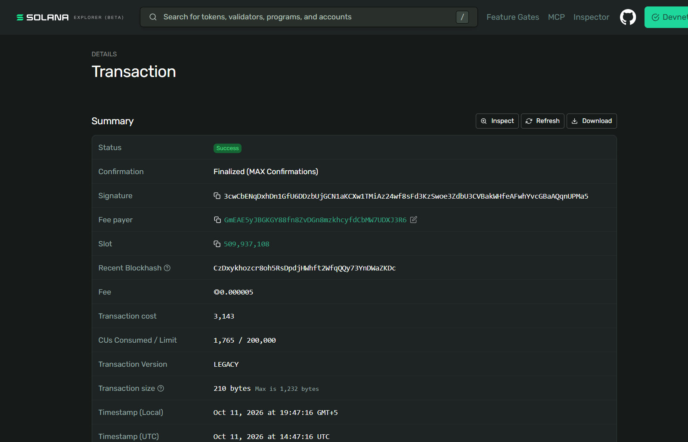
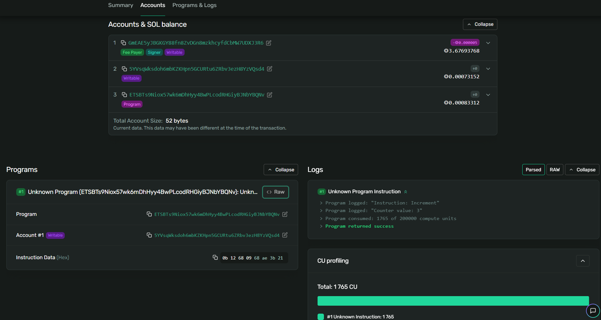
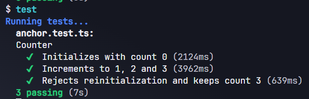

# Задание 5. Counter на Anchor

Программа-счётчик написана на Rust с использованием Anchor.
Разработана в Solana Playground и загружена в Solana Devnet.

## Инструкции программы

- initialize — создаёт аккаунт счётчика со значением 0.
- increment — увеличивает значение на 1.

Значение count хранится в аккаунте Solana как число u64.
При увеличении используется checked_add для защиты от переполнения.
В этой учебной версии увеличивать счётчик может любой пользователь.

## Файлы

- src/lib.rs — код программы.
- client/client.ts — создание счётчика, три увеличения и чтение результата.
- tests/anchor.test.ts — автоматические тесты.

## Запуск в Solana Playground

1. Создать проект типа Anchor.
2. Вставить код программы в src/lib.rs.
3. Выполнить build. Playground обновит declare_id для нового проекта.
4. Выполнить deploy в сети Devnet.
5. Вставить код клиента в client/client.ts и выполнить run.
6. Вставить тесты в tests/anchor.test.ts и выполнить test.

Кошелёк Playground должен иметь тестовые SOL.
Каждый запуск клиента создаёт новый аккаунт счётчика.

## Результат

Клиент прочитал значения из аккаунта в Devnet:
0 → 1 → 2 → 3.

Последняя транзакция увеличения имеет статус Success и Finalized.
В логах отображается Counter value: 3.

## Адреса и ссылки

Program ID:
ETSBTs9Niox57wk6mDhHyy4BwPLcodRHGiyBJNbYBQNv

Программа:
https://explorer.solana.com/address/ETSBTs9Niox57wk6mDhHyy4BwPLcodRHGiyBJNbYBQNv?cluster=devnet

Аккаунт счётчика:
https://explorer.solana.com/address/5YVsqWksdoh6mbKZKHpn5GCURtu6ZRbv3ezH8YzVQsd4?cluster=devnet

Транзакция увеличения до 3:
https://explorer.solana.com/tx/3cwCbENqDxhDn1GfU6DDzbUjGCN1aKCXw1TMiAz24wf8sFd3KzSwoe3ZdbU3CVBakWHfeAFwhYvcGBaAQqnUPMa5?cluster=devnet

## Тесты

Успешно выполнены три проверки:

1. Создание счётчика со значением 0.
2. Увеличение значения до 1, 2 и 3.
3. Отклонение повторной инициализации с сохранением значения 3.

Результат: 3 passing.

## Скриншоты

Работа клиента:

Успешная транзакция:

Логи программы:

Результат тестов:

